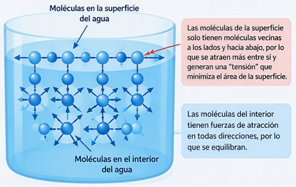
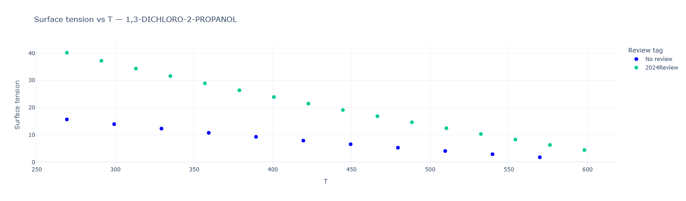
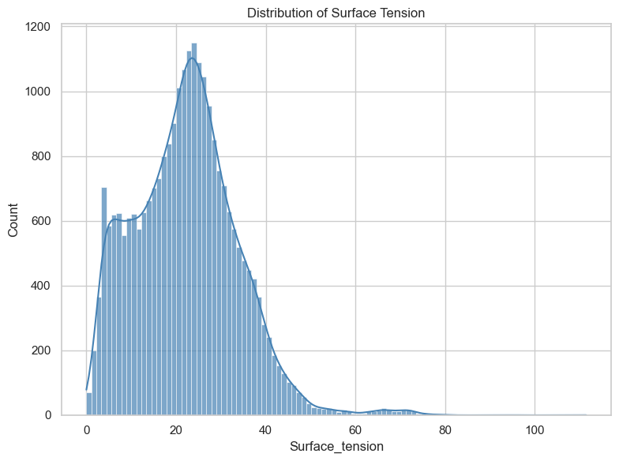
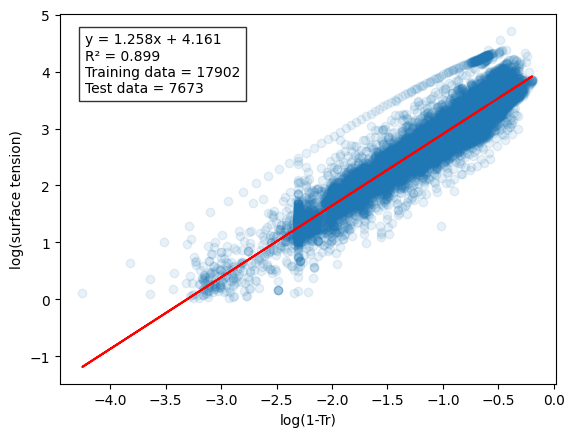
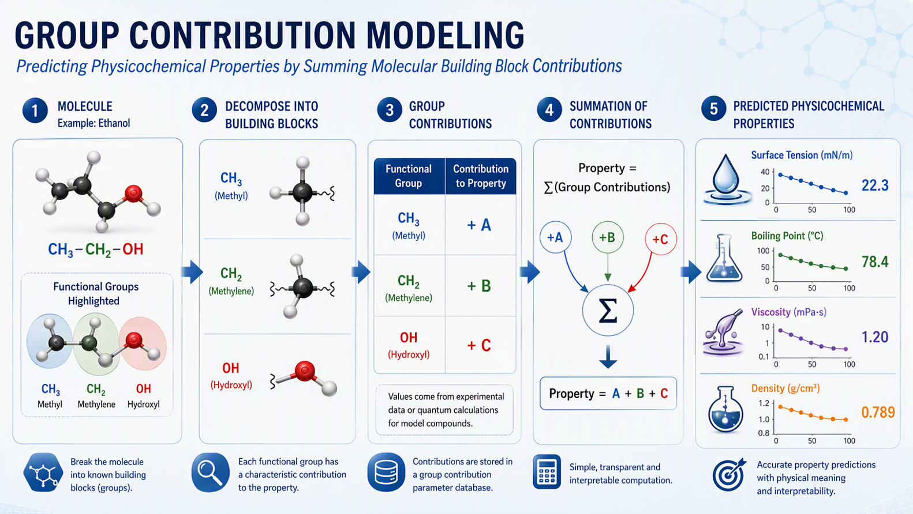
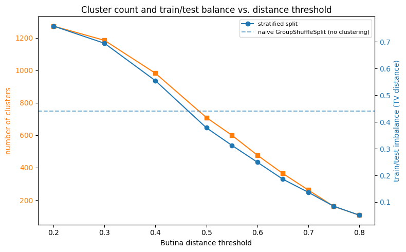
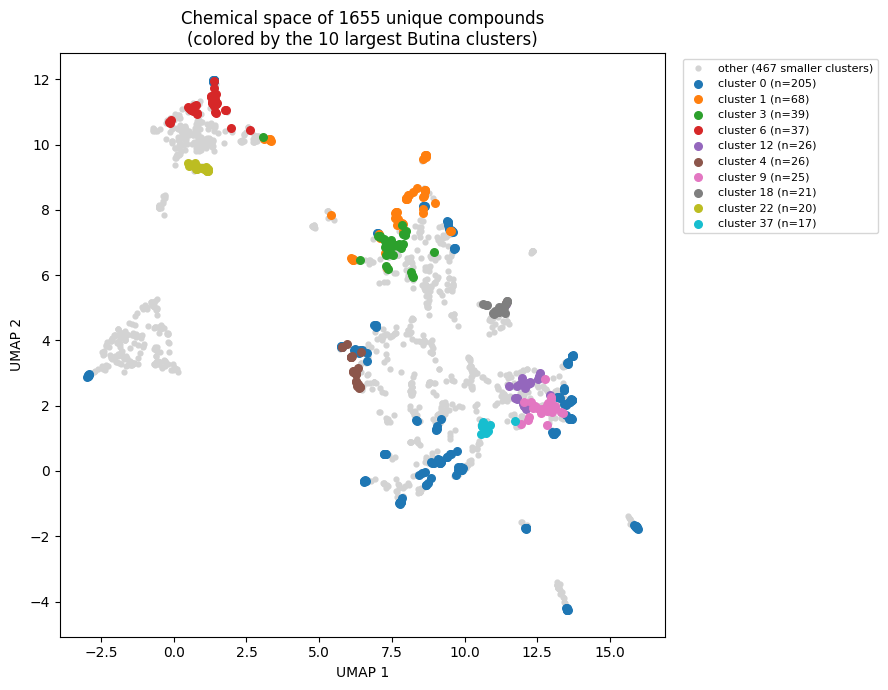
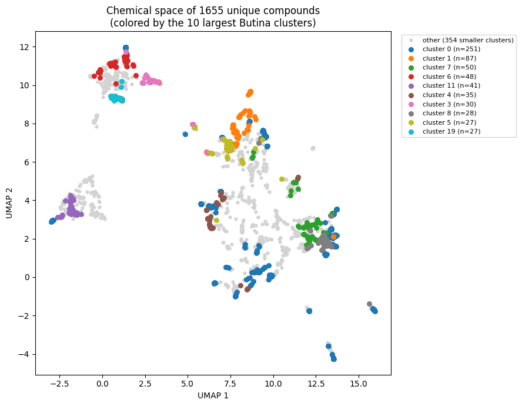
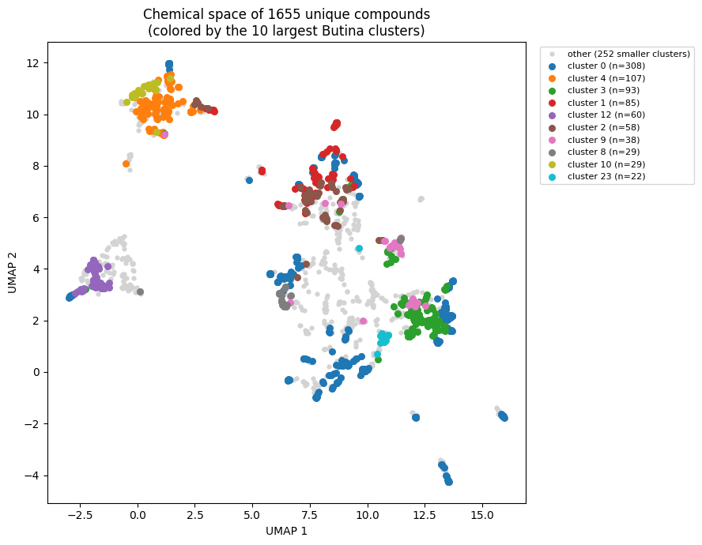

## Motivación para el proyecto

La tensión superficial es una propiedad física de los líquidos, y es la fuerza que hace que la superficie de ese líquido se comporte como una membrana elástica, debido a la atracción entre sus moléculas. Sus unidades son mN/m, y es una propiedad dependiente de la temperatura.

{fig-align="center"}

Esta propiedad debe controlarse en productos que deben interactuar con una superficie, dispersarse, formar una película, generar gotas o penetrar en un sustrato. Por ejemplo, cuando se fabrican tintas para impresión digital:

-   Si la tensión superficial es muy alta, la gota de tinta no moja suficientemente la superficie (del papel, tela, film…) y por lo tanto puede retraerse y producir una cobertura deficiente.

-   Si es muy baja, entonces la gota puede extenderse demasiado, aumentando efectos como el bleeding o la pérdida de definición.

-   Solo si es adecuada, se puede controlar el tamaño del punto, la uniformidad, la cobertura y la calidad de impresión.

Lubrizol tiene varios productos en su sector de Surface Sciences, que deben tener controlada esa propiedad. Los tipos de productos son:

-   Dispersiones, dispersantes, resinas y modificadores de superficie para tintas digitales sobre textiles, films, papel y cerámica.

-   Pinturas y coatings.

-   Wetting and dispersing agents, son tecnologías que permiten una mejor dispersión de los pigmentos.

-   Formulaciones de personal care y beauty.

### ¿Cómo se mide la tensión superficial?

Esta propiedad se mide usando un tensiómetro y existen varios métodos experimentales para poder hacerlo, como, por ejemplo:

-   Placa de Wilhelmy: una pequeña placa de platino entra en contacto con el líquido. Se mide la fuerza que el líquido ejerce sobre la placa y con ella se determina la tensión superficial.

-   Anillo de Du Noüy: se introduce un anillo de platino en el líquido y después se tira de él hacia arriba. Se mide la fuerza máxima necesaria para deformar/separar la superficie.

-   Pendant drop: se genera una gota y una cámara analiza su forma, y mediante la ecuación de Young-Laplace y la diferencia de densidades, se obtiene la tensión superficial.

### ¿Qué aporta este proyecto?

Podemos ver que la propiedad solo puede medirse cuando ya se ha fabricado el compuesto, en cambio, el modelo nos da una estimación del compuesto antes de sintetizarlo. Gracias al modelo, podemos crear miles de formulaciones, y mirar cómo se comportarán a cierta temperatura. Así escogemos solo aquellos candidatos que podrían ser mejores para la aplicación buscada.

A efectos de empresa, esto permitiría poder hacer un screening amplio de formulaciones en minutos, y solo aplicar las pruebas experimentales a los candidatos más prometedores, ayudando así a agilizar la innovación de productos reduciendo tiempo y coste.

## Dataset

Para este proyecto, se usarán los datos de una base de datos propietaria, con lo cual no se publicarán en GitHub ni los datos ni los modelos resultantes, solo el código usado.

Los campos que se cogen de la base de datos son:

-   ChemID: identificador del compuesto químico.

-   Name: nombre del compuesto.

-   Formula: formula del compuesto.

-   SMILES: código smiles del compuesto.

-   Structure: estructura del compuesto.

-   Family: familia a la que pertenece el compuesto.

-   Std_State: indica el estado de la materia en que se encuentra el compuesto.

-   T: temperatura.

-   Surface_tension: tensión superficial en N/m.

-   TC: temperatura crítica.

-   Error: incertidumbre asociada al valor guardado en la base de datos.

-   Acceptance: estado de aceptación de los datos:

    -   A = Accepted. Datos aceptados por el staff del proyecto.

    -   N = Not used (but aceptable). Datos aceptables, pero con precisión menor o igual a las de los valores aceptados. Dentro del doble de la incertidumbre o no usados debido a tendencias inconsistentes.

    -   U = Unevaluated. Datos no evaluados por el staff del proyecto.

    -   R = Rejected. Datos rechazados debido a que se desvían más del doble de la incertidumbre o se consideran poco fiables.

### Limpieza y transformaciones

Tras la importación de los datos, tenemos **52225** valores de tensión superficial.

Para este proyecto, se usarán solo los datos con Acceptance ==’A’ y con incertidumbres menores al 25%. También tendremos en cuenta que, al ser una propiedad de los líquidos, solo usaremos aquellos compuestos cuyo estado de la materia sea L.

``` python
df = df[df["Acceptance"] == "A"]
df = df[df["error_numeric"] <= 0.25]
df = df[df["Std_state"] == "L"]
```

Si observamos los datos, vemos que tenemos más nombres únicos que códigos SMILES. Al revisar, vemos que hay compuestos que tienen la coletilla \_YYYY, que según la documentación de la base de datos nos indica que se hizo una revisión de las propiedades de ese parámetro en el año indicado. Guardamos esa información en una nueva columna, y lo eliminamos del nombre.

``` python
# Patrón: _YYYYReview
pattern = r'_(\d{4}Review)'

# Filas afectadas
mask = df['Name'].str.contains(pattern, regex=True, na=False)

# Extraer el sufijo (sin el _ inicial)
df.loc[mask, 'review_tag'] = (
    df.loc[mask, 'Name']
      .str.extract(pattern)[0]
)

# Eliminar el sufijo del Name
df.loc[mask, 'Name'] = (
    df.loc[mask, 'Name']
      .str.replace(pattern, '', regex=True)
)

# Concatenar en Note (respetando NaN)
df.loc[mask, 'Note'] = (
    df.loc[mask, 'Note']
      .fillna('')
      .str.strip()
      .where(df.loc[mask, 'Note'].notna(), '')
      + ' '
      + df.loc[mask, 'review_tag']
).str.strip()
```

Vamos a auditar esos valores revisados para no tener compuestos con valores muy distintos entre la primera vez que se introdujeron y la revisión.



Le pedimos a la IA que genere el código para hacer esa comprobación y limpiar el dataset.

``` python
import numpy as np
import pandas as pd

# ============================================================
# CONFIGURACIÓN
# ============================================================

# Diferencia absoluta permitida en Surface_tension
ABS_TOL = 2.0

# Diferencia relativa permitida: 5 %
REL_TOL = 0.05


# ============================================================
# PREPARAR LOS DATOS
# ============================================================

df_model = df.copy()

# Asegurar que las columnas numéricas sean realmente numéricas
df_model["T"] = pd.to_numeric(
    df_model["T"],
    errors="coerce"
)

df_model["Surface_tension"] = pd.to_numeric(
    df_model["Surface_tension"],
    errors="coerce"
)

# Eliminar filas sin Name, temperatura o Surface_tension
df_model = df_model.dropna(
    subset=["Name", "T", "Surface_tension"]
).copy()

# Temperatura redondeada al entero más cercano
df_model["T_integer"] = (
    df_model["T"]
    .round()
    .astype(int)
)

# Identificar si el dato está revisado
df_model["is_reviewed"] = df_model["review_tag"].notna()


# ============================================================
# COMPARAR REVISADOS Y NO REVISADOS
# ============================================================

comparison_rows = []

for (name, temperature), group in df_model.groupby(
    ["Name", "T_integer"],
    dropna=False
):

    reviewed = group.loc[
        group["is_reviewed"],
        "Surface_tension"
    ]

    not_reviewed = group.loc[
        ~group["is_reviewed"],
        "Surface_tension"
    ]

    # Solo se puede comparar si existen datos de ambos tipos
    if not reviewed.empty and not not_reviewed.empty:

        # Usamos la mediana para que la comparación sea robusta
        # frente a valores extremos
        reviewed_value = reviewed.median()
        not_reviewed_value = not_reviewed.median()

        absolute_difference = abs(
            reviewed_value - not_reviewed_value
        )

        relative_difference = (
            absolute_difference / abs(reviewed_value)
            if reviewed_value != 0
            else np.inf
        )

        # La diferencia se considera importante solamente si supera
        # tanto la tolerancia absoluta como la relativa.
        #
        # Equivale a:
        # difference > max(ABS_TOL, reviewed_value * REL_TOL)
        values_are_different = (
            absolute_difference > ABS_TOL
            and relative_difference > REL_TOL
        )

        tolerance_used = max(
            ABS_TOL,
            abs(reviewed_value) * REL_TOL
        )

    else:
        reviewed_value = (
            reviewed.median()
            if not reviewed.empty
            else np.nan
        )

        not_reviewed_value = (
            not_reviewed.median()
            if not not_reviewed.empty
            else np.nan
        )

        absolute_difference = np.nan
        relative_difference = np.nan
        tolerance_used = np.nan
        values_are_different = False

    comparison_rows.append(
        {
            "Name": name,
            "T_integer": temperature,
            "n_reviewed": len(reviewed),
            "n_not_reviewed": len(not_reviewed),
            "reviewed_median": reviewed_value,
            "not_reviewed_median": not_reviewed_value,
            "absolute_difference": absolute_difference,
            "relative_difference": relative_difference,
            "tolerance_used": tolerance_used,
            "values_are_different": values_are_different,
        }
    )


comparison = pd.DataFrame(comparison_rows)


# ============================================================
# AÑADIR EL RESULTADO DE LA COMPARACIÓN AL DATAFRAME
# ============================================================

df_model = df_model.merge(
    comparison[
        [
            "Name",
            "T_integer",
            "n_reviewed",
            "n_not_reviewed",
            "reviewed_median",
            "not_reviewed_median",
            "absolute_difference",
            "relative_difference",
            "tolerance_used",
            "values_are_different",
        ]
    ],
    on=["Name", "T_integer"],
    how="left"
)


# ============================================================
# DECIDIR QUÉ FILAS CONSERVAR
# ============================================================

# Se elimina una fila solamente cuando:
#
# 1. El grupo tiene datos revisados y no revisados.
# 2. Las medianas son claramente diferentes.
# 3. La fila concreta no está revisada.

df_model["remove_from_model"] = (
    df_model["values_are_different"]
    & ~df_model["is_reviewed"]
)

df_model["selection_reason"] = np.select(
    [
        df_model["remove_from_model"],

        (
            df_model["n_reviewed"].gt(0)
            & df_model["n_not_reviewed"].gt(0)
            & ~df_model["values_are_different"]
        ),

        (
            df_model["n_reviewed"].gt(0)
            & df_model["n_not_reviewed"].eq(0)
        ),

        (
            df_model["n_reviewed"].eq(0)
            & df_model["n_not_reviewed"].gt(0)
        ),
    ],
    [
        "Removed: different from reviewed values",
        "Kept: reviewed and non-reviewed values are similar",
        "Kept: only reviewed values available",
        "Kept: only non-reviewed values available",
    ],
    default="Kept",
)


# ============================================================
# DATAFRAME FINAL PARA EL MODELO
# ============================================================

df_final = (
    df_model.loc[~df_model["remove_from_model"]]
    .copy()
    .drop(
        columns=[
            "remove_from_model",
        ]
    )
    .reset_index(drop=True)
)
df_final = df_final[df.columns]

# ============================================================
# DATAFRAME DE FILAS ELIMINADAS PARA AUDITORÍA
# ============================================================

df_removed = (
    df_model.loc[df_model["remove_from_model"]]
    .copy()
    .reset_index(drop=True)
)


# ============================================================
# RESUMEN DE LAS DECISIONES
# ============================================================

comparison["decision"] = np.select(
    [
        comparison["values_are_different"],

        (
            comparison["n_reviewed"].gt(0)
            & comparison["n_not_reviewed"].gt(0)
        ),

        comparison["n_reviewed"].gt(0),
    ],
    [
        "Keep reviewed only",
        "Keep both",
        "Keep reviewed",
    ],
    default="Keep non-reviewed",
)

comparison = comparison.sort_values(
    [
        "values_are_different",
        "absolute_difference",
    ],
    ascending=[
        False,
        False,
    ],
    na_position="last",
).reset_index(drop=True)
```

Usamos los códigos SMILES para mirar si el compuesto contiene Carbono, Oxígeno, Sulfuro, Fósforo o Nitrógeno. Solo seleccionaremos aquellos que tengan dichos elementos, pues son los más usados en las formulaciones de la empresa.

``` python
def extract_elements(smiles):
    """
    Extract atomic symbols from SMILES string.
    
    Handles:
    - Aromatic atoms (c, n, o)
    - Multi-character atoms (Cl, Br, Si, etc.)
    """
    if pd.isna(smiles):
        return set()

    # Match element tokens:
    # - Uppercase + optional lowercase (e.g., Cl, Si)
    # - or lowercase aromatic atoms
    tokens = re.findall(r'[A-Z][a-z]?|[cnosp]', smiles)

    # Normalize aromatic (lowercase) to uppercase
    elements = set(token.upper() for token in tokens)

    return elements

def has_required_elements(elements):
    results = []
    for element in elements:
        results.append(element in required_elements)
    return(any(results))

required_elements = {"C", "O", "S", "P", "N"}
df["elements"] = df["SMILES"].apply(extract_elements)
df["has_CHOSPN"] = df["elements"].apply(has_required_elements)
df = df[df["has_CHOSPN"]].copy()
```

El dataset final tiene **25649** valores de Tensión superficial.

Sabiendo que las unidades de TS de la base de datos son N/m y que normalmente se mira en mN/m, hacemos la conversión de esa columna.

``` python
 df["Surface_tension"] = df["Surface_tension"]*1000
```

La distribución de nuestra variable target es:

{fig-align="center"}

### ¿Podríamos usar este dataset para crear un modelo?

Podríamos usar la ecuación de Yaws: $\sigma = A(1-T_r)^n$ donde $T_r = \frac{T}{T_c}$

Podríamos covertirla en una recta usando logaritmos, y obtendríamos una ecuación que podemos usar para crear un modelo lineal.$$\log \sigma = \log A + n \log(1-T_r)$$

No vamos a explicar este modelo, solo mostrar que, aunque el resultado es bueno, este modelo obliga a tener el valor de la temperatura crítica para cada nueva predicción, y por lo tanto limita el uso de este.

{fig-align="center"}

### Generando variables químicas

Debido a lo anterior, vamos a usar datos químicos para poder crear modelos para los cuales siempre tendremos todos los datos a la hora de predecir.

Generaremos tres datasets:

1.  Descriptores para contribución de grupos

2.  Descriptores químicos (Morgan fingertips, descriptores estructurales, electroestáticos...)

3.  Grafos moleculares

Seguiremos la estrategia de separación de los datos propuesta por Aouichaoui et al. (2025) para asegurarnos de que el dataset de entrenamiento tiene una buena cobertura de grupos y diversidad química, para así asegurarnos de poder hacer una buena comparación entre Group Contribution (GC) y Machine Learning (ML).

Se creará un único dataset con todos los descriptores, así que se guardarán variables con los nombres de las columnas que corresponden a cada grupo usando la librería pickle. También se guarda el set de datos final usando pickle.

#### Group Contribution

La contribución de grupos es un método donde cogemos una molécula, la descomponemos en grupos funcionales, y miramos cómo la suma de dichos grupos contribuye a la propiedad X de dicha molécula.



Teniendo en cuenta los compuestos que componen este dataset, crearemos la columna de grupos como:

``` python
GROUP_SMARTS = {
    "hydroxyl": "[OX2H]",
    "carboxylic_acid": "[CX3](=O)[OX2H1]",
    "ester": "[CX3](=O)[OX2][#6]",
    "ether": "[OD2]([#6])[#6]",
    "aldehyde": "[CX3H1](=O)[#6,H]",
    "ketone": "[#6][CX3](=O)[#6]",
    "primary_amine": "[NX3;H2;!$(NC=O)]",
    "secondary_amine": "[NX3;H1;!$(NC=O)]",
    "tertiary_amine": "[NX3;H0;!$(N-C=O)]",
    "amide": "[NX3][CX3](=[OX1])",
    "nitrile": "[CX2]#N",
    "alkene": "[CX3]=[CX3]",
    "alkyne": "[CX2]#[CX2]",
    "aromatic_atom": "[a]",
    "fluorine": "[F]",
    "chlorine": "[Cl]",
    "bromine": "[Br]",
    "iodine": "[I]",
    "sulfur_atom": "[S]",
    "phosphorus_atom": "[P]"
}

GROUP_PATTERNS = {
    name: Chem.MolFromSmarts(smarts)
    for name, smarts in GROUP_SMARTS.items()
}

def mol_to_group_features(mol):
    if mol is None:
        return None

    row = {
        "n_C": sum(a.GetAtomicNum() == 6 for a in mol.GetAtoms()),
        "n_N": sum(a.GetAtomicNum() == 7 for a in mol.GetAtoms()),
        "n_O": sum(a.GetAtomicNum() == 8 for a in mol.GetAtoms()),
        "n_S": sum(a.GetAtomicNum() == 16 for a in mol.GetAtoms()),
        "ring_count": Descriptors.RingCount(mol),
        "aromatic_ring_count": Descriptors.NumAromaticRings(mol),
        "rotatable_bonds": Descriptors.NumRotatableBonds(mol),
        "h_donors": Descriptors.NumHDonors(mol),
        "h_acceptors": Descriptors.NumHAcceptors(mol),
    }

    for name, pattern in GROUP_PATTERNS.items():
        row[name] = len(mol.GetSubstructMatches(pattern))

    return row

group_features = pd.DataFrame(df["mol"].apply(mol_to_group_features).tolist(), index=df.index)
compound_features_df = pd.concat([df.reset_index(drop=True), group_features.reset_index(drop=True)], axis=1)
group_cols = list(group_features.columns)
group_cols.append('T')
```

En este dataset tendremos 30 predictores, 29 de los cuales son contajes de grupos.

#### Descriptores químicos

Analizando los diferentes descriptores químicos que nos ofrece el paquete de RDkit. Se escogen los siguientes:

-   Descriptores de polaridad e interacciones intermoleculares

    -   TPSA: Topological Polar Surface Area

    -   LogP: mide el balance entre el comportamiento hidrofóbico y el hidrofílico. Nos da información de la polaridad y la hidrofobicidad.

-   Cargas parciales. Para poder mirar las cargas parciales, debemos calcular las cargas de cada átomo de la molécula primero (lo hacemos calculando las Gasteiger partial charges para cada átomo). Así Obtendremos los valores que nos darán las cargas máximas y mínimas de cada compuesto.

-   E-State: el estado electrotopologico combina la información topologica molecular y el entorno electrónico.

-   Descriptores de tamaño y dispersión: peso molecular y contaje de átomos pesados.

-   Descriptores de enlaces de hidrógeno: importantes ya que este tipo de enlaces influencian las fuerzas intermoleculares cohesivas en un líquido.

-   LabuteASA: nos da una aproximación de la superficie molecular describiendo lo grande que es la molécula y el tipo de superficie que tiene.

-   SlogP_VSA: nos divide el área de la superficie molecular según la contribución de la superficie de van der Waals al valor de LogP.

-   PEOE_VSA: se refiere a la información que aportan las cargas parciales. Lo que nos mira es cómo los rangos de diferencias entre cargas parciales de los átomos afecta a la superficie molecular.

-   SMR_VSA: dan información de la polarizabilidad y de las características de volumen y dispersión de la molécula.

-   Descriptores estructurales: proporcionan características estructurales básicas.

    -   Contaje de anillos, que nos da información de la ciclicidad.

    -   Anillos aromáticos, que captura todas aquellas estructuras aromáticas.

    -   Enlaces rotables, que nos proporciona una medida de la flexibilidad de la molécula.

-   Morgan Fingerprints: es una codificación de fragmentos estructurales de las moléculas. Hay 2048 fragmentos. Si el valor para un fingertip es 1, entonces es que ese fragmento está presente en la molécula.

Pasando todos los que queremos a una IA, nos da el siguiente código para su extracción:

``` python
from rdkit.Chem import Lipinski
from rdkit.Chem import rdMolDescriptors
from rdkit.Chem import Crippen
from rdkit.Chem import EState

#===================================#
#              HELPERS              #
#===================================#
def get_partial_charges(mol):
    """
    Gasteiger partial charges are a method for assigning atomic 
    partial charges in molecular modeling, crucial for accurate 
    electrostatics calculations and molecular simulations
    """
    if mol is None:
        return np.nan, np.nan
    try:
        AllChem.ComputeGasteigerCharges(mol)
        charges = np.array([float(atom.GetProp("_GasteigerCharge")) 
                            for atom in mol.GetAtoms()])

        # Remove possible NaN/Inf values
        charges = charges[np.isfinite(charges)]
        if len(charges) == 0:
            return np.nan, np.nan
        return charges.max(), charges.min()
    except Exception:
        return np.nan, np.nan

#===================================#
#            DESCRIPTORS            #
#===================================#
descriptor_cols = ["TPSA","LogP","MaxPartialCharge","MinPartialCharge",
                   "MaxEStateIndex","MolWt","HeavyAtomCount","NumHDonors",
                   "NumHAcceptors","NHOHCount","LabuteASA","RingCount",
                   "NumAromaticRings","NumRotatableBonds"]
descriptor_cols += [f"SlogP_VSA{i}" for i in range(1, 13)]
descriptor_cols += [f"PEOE_VSA{i}" for i in range(1, 15)]
descriptor_cols += [f"SMR_VSA{i}" for i in range(1, 11)]

# TPSA is the topological polar surface area
df["TPSA"] = df["mol"].apply(lambda mol: rdMolDescriptors.CalcTPSA(mol))

# LogP measures the balance between hydrophobic and hydrophilic behavior
df["LogP"] = df["mol"].apply(lambda mol: Crippen.MolLogP(mol))

# Partial charges: most positive and most negative charged regions
charges = df["mol"].apply(get_partial_charges)
df["MaxPartialCharge"] = charges.apply(lambda x: x[0])
df["MinPartialCharge"] = charges.apply(lambda x: x[1])

# Electropological state: combines information about molecular topology and electronic environment
df["MaxEStateIndex"] = df["mol"].apply(lambda mol: EState.MaxEStateIndex(mol))

# Molecular weight
df["MolWt"] = df["mol"].apply(lambda mol: Descriptors.MolWt(mol))

# Heavy atom account
df["HeavyAtomCount"] = df["mol"].apply(lambda mol: Lipinski.HeavyAtomCount(mol))

# Hydrogen bonding can influence cohesive intermolecular forces in a liquid
# Hydrogen bond donors
df["NumHDonors"] = df["mol"].apply(lambda mol: Lipinski.NumHDonors(mol))

# Hydrogen bond acceptors
df["NumHAcceptors"] = df["mol"].apply(lambda mol: Lipinski.NumHAcceptors(mol))

# NHOH Count
df["NHOHCount"] = df["mol"].apply(lambda mol: Lipinski.NHOHCount(mol))

# LabuteASA: gives information about size and surface
df["LabuteASA"] = df["mol"].apply(lambda mol: rdMolDescriptors.CalcLabuteASA(mol))

# SlogP_VSA
# How much of this molecule's van der Waals surface belongs to atoms falling into different LogP contribution ranges?
for i in range(1, 13):
    descriptor = getattr(Descriptors, f"SlogP_VSA{i}")
    df[f"SlogP_VSA{i}"] = df["mol"].apply(descriptor)

# PEOE_VSA
# How much molecular surface is associated with atoms having different partial-charge ranges?
for i in range(1, 15):
    descriptor = getattr(Descriptors, f"PEOE_VSA{i}")
    df[f"PEOE_VSA{i}"] = df["mol"].apply(descriptor)

# SMR_VSA
# information related to polarizability and molecular volume/dispersion characteristics
for i in range(1, 11):
    descriptor = getattr(Descriptors, f"SMR_VSA{i}")
    df[f"SMR_VSA{i}"] = df["mol"].apply(descriptor)

# Structural descriptors
# Ring count: gives information about cyclicity
df["RingCount"] = df["mol"].apply(lambda mol: Lipinski.RingCount(mol))

# Aromatic rings: captures aromatic structure
df["NumAromaticRings"] = df["mol"].apply(lambda mol: Lipinski.NumAromaticRings(mol))

# Rotatable bonds: rough measure of molecular flexibility
df["NumRotatableBonds"] = df["mol"].apply(lambda mol: Lipinski.NumRotatableBonds(mol))

#===================================#
#             FINGERTIPS            #
#===================================#
morgan_generator = AllChem.GetMorganGenerator(radius=2, fpSize=2048)

def get_morgan_fp(mol):
    fp = morgan_generator.GetFingerprint(mol)
    return np.array(fp)

morgan_array = np.vstack(df["mol"].apply(get_morgan_fp))
morgan_cols = [f"fm_{i}" for i in range(2048)]
df_morgan = pd.DataFrame(morgan_array, columns=morgan_cols, index=df.index)
df = pd.concat([df, df_morgan], axis=1)
morgan_cols = [f"fm_{i}" for i in range(2048)]
```

## Modelado

### ¿Cómo separamos los datos?

Lo primero que vamos a hacer es verificar que nuestro dataset con los descriptores, no tenga ningún NaN.

``` python
bad_mask = ~np.isfinite(df[descriptor_cols].to_numpy(dtype=float)).all(axis=1)
bad_chemids = df.loc[bad_mask, "ChemID"].unique()
n_total = df["ChemID"].nunique()
print(f"{len(bad_chemids)} of {n_total} compounds ({len(bad_chemids) / n_total:.2%}) "
      f"have NaN/inf descriptors ({bad_mask.sum()} of {len(df)} rows)")

affected = df.loc[bad_mask, descriptor_cols].replace([np.inf, -np.inf], np.nan).isna().sum()
print(affected[affected > 0])

df = df[~df["ChemID"].isin(bad_chemids)].reset_index(drop=True)
print(f"{df['ChemID'].nunique()} compounds / {len(df)} rows remain")
```

Cuando ejecutamos ese código, vemos que 4 compuestos tienen los descriptores MaxPartialCharge y MinPartialCharge como NaN/inf. Así que quitaremos esas filas del dataset antes de separar los datos.

#### Estrategia de separación de datos

Cuando hablamos de datasets químicos, no podemos simplemente dividir de manera aleatoria los datos sino que debemos tener en cuenta dos cosas:

1.  No debe existir la misma molécula tanto en los datos de entreno como en los de test.

2.  Los diferentes grupos químicos deben estar representados de manera balanceada entre los distintos dataset, así nos aseguramos de no estar entrenando para una familia química en concreto y probándolo en familias químicas que nunca antes ha visto.

Lo primero se puede conseguir con un simple GroupShuffleSplit (de la librería de scikit-learn), agrupando por el ChemID. Pero, con ese método no resolveríamos lo segundo. Es por eso que vamos a aplicar la estrategia del paper anteriormente mencionado. Para ello, tendremos que calcular la similitud entre las moléculas y luego agrupar los valores (clustering de los grupos).

#### Cálculo de la similitud

Para calcular la similitud entre moléculas, usaremos los Morgan fingerprints. Que dos moléculas sean parecidas en términos de los fingerprits es que tendrán varios de los mismos fragmentos presentes. Para la comparación de fingertips se usa la similaridad de Tanimoto que mira todos los bits == 1 que comparten dos moléculas y lo divide entre el número total de bits == 1 que tiene cada una. El valor resultante va de 0 a 1, donde 0 es que no tienen nada en común y 1 que tienen exactamente los mismos fingertips.

Lo primero, sacaremos los ChemID únicos de nuestro dataset, ya que la propiedad escogida depende de la temperatura, cada ChemID puede aparecer muchas veces.

Con el siguiente código, obtendremos el número de moléculas únicas en nuestro dataset, **1655**, y calcularemos los fingerprints para cada una de ellas, y usando esos fingerprints calcularemos la similitud entre cada una mediante Tanimoto.

``` python
unique_df = df.drop_duplicates(subset="ChemID", keep="first")[["ChemID", "mol"]].reset_index(drop=True)
print(f"{len(unique_df)} unique compounds")

fps = [morgan_generator.GetFingerprint(mol) for mol in unique_df["mol"]]

n_compounds = len(fps)
dists = []
for i in range(1, n_compounds):
    sims = DataStructs.BulkTanimotoSimilarity(fps[i], fps[:i])
    dists.extend([1 - s for s in sims])
```

Ahora debemos agruparlas en clusters según esa similaridad, y para ello usaremos el algoritmo de clusterización Butina:

``` python
clusters = Butina.ClusterData(dists, n_compounds, distThresh=0.6, isDistData=True)

cluster_id = np.empty(n_compounds, dtype=int)
for cid, members in enumerate(clusters):
    for idx in members:
        cluster_id[idx] = cid
unique_df["cluster_id"] = cluster_id

print(f"Found {len(clusters)} clusters")
print("Largest cluster size:", len(clusters[0]))
print("Number of singleton clusters:", sum(1 for c in clusters if len(c) == 1))

# Carry the cluster label from each unique compound onto every row of df (every temperature point)
chemid_to_cluster = dict(zip(unique_df["ChemID"], unique_df["cluster_id"]))
df["cluster_id"] = df["ChemID"].map(chemid_to_cluster)
assert df["cluster_id"].isna().sum() == 0
```

Como el parámetro que podemos controlar con Butina es únicamente el Threshold de la distancia (que es lo que nos indica cuán similares son o no), para validar qué distancia sería mejor usar, vamos a mirar cómo de balanceados están los datos entre test y train una vez hacemos el split proporcional (StratifiedGroupKFold).



En el gráfico podemos ver que cuando el valor del threshold es muy bajo, tenemos demasiados clústers, muchos con solo 1 molécula en ellos. Debido a eso, no hay una posibilidad de separar los datos de manera balanceada entre test y train. Thresholds menores de 0.5, funcionan peor que si usamos el GroupShuffle, que ignora la química por completo.

A partir de 0.6, vemos que hay un buen balance entre los datasets. Pero, para decidir, debemos evaluar si los clústers tienen sentido químico, es decir, menos clústers son simplemente agrupaciones de compuestos que no tienen gran similitud y por lo tanto perdemos el objetivo de hacer esto.

Una manera de ver los clusters es haciendo un plot de UMAP (Uniform Manifold Approximation), ya que así comprimimos cada compuesto a solo 2 coordenadas pero preservando la estructura de los vecinos locales. Entrenamos el reductor de UMAP usando las distancias de Tanimoto calculadas.

``` python
import umap
import matplotlib.pyplot as plt

# Build the full n x n distance matrix from the same Tanimoto distances used for clustering.
# We build it directly (rather than via scipy's squareform) since squareform assumes a
# different pair ordering than the one the Butina recipe above produces.
dist_matrix = np.zeros((n_compounds, n_compounds))
for i in range(1, n_compounds):
    sims = DataStructs.BulkTanimotoSimilarity(fps[i], fps[:i])
    row = 1 - np.array(sims)
    dist_matrix[i, :i] = row
    dist_matrix[:i, i] = row

reducer = umap.UMAP(n_components=2, metric="precomputed", n_neighbors=15, min_dist=0.1, random_state=42)
coords = reducer.fit_transform(dist_matrix)
unique_df["umap_x"] = coords[:, 0]
unique_df["umap_y"] = coords[:, 1]

# Only label the largest clusters individually; everything else stays gray ("other")
N_HIGHLIGHT = 10
top_clusters = unique_df["cluster_id"].value_counts().head(N_HIGHLIGHT).index

plt.figure(figsize=(9, 7))
other = unique_df[~unique_df["cluster_id"].isin(top_clusters)]
plt.scatter(other["umap_x"], other["umap_y"], c="lightgray", s=12,
            label=f"other ({unique_df['cluster_id'].nunique() - N_HIGHLIGHT} smaller clusters)")

cmap = plt.get_cmap("tab10")
for i, cid in enumerate(top_clusters):
    members = unique_df[unique_df["cluster_id"] == cid]
    plt.scatter(members["umap_x"], members["umap_y"], color=cmap(i % 10), s=30, label=f"cluster {cid} (n={len(members)})")

plt.legend(bbox_to_anchor=(1.02, 1), loc="upper left", fontsize=8)
plt.xlabel("UMAP 1")
plt.ylabel("UMAP 2")
plt.title(f"Chemical space of {len(unique_df)} unique compounds\n(colored by the {N_HIGHLIGHT} largest Butina clusters)")
plt.tight_layout()
plt.show()
```

Miramos ese gráfico para 3 thresholds:

-   0.6 -\> tenemos 477 clústers, el mayor de los cuales contiene 205 compuestos (12.4% de todos los que hay).

    

-   0.65 -\> tenemos 364 clústers, el mayor de los cuales contiene 251 compuestos (15.2% de todos los que hay).

    

-   0.7 -\> tenemos 262 clústers, el mayor de los cuales contiene 308 compuestos (18.6% de todos los que hay).

    

Si miramos los clústers de cada caso con las agrupaciones por Family de la base de datos, vemos que el mayor de cada caso contiene entre el 40 al 50% de las familias. Así que, vamos a mirar 2 versiones de split: una usando los clústers de Butina con el threshold 0.7, y otro dividiendo según las familias.

Para ambas versiones, lo que usaremos es el StratifiedGroupKFolds ya que necesitamos que los chemID que aparezcan en train no salgan en test, y además, necesitamos que las proporciones de compuestos similares (sea por similaridad calculada o por pertenecer a la misma familia), estén también equilibradas entre train/test.

Para los datasets de Butina:

``` python
sgkf = StratifiedGroupKFold(n_splits=3, shuffle=True, random_state=42)
train_idx, test_idx = next(sgkf.split(df, y=df["cluster_id"], groups=df["ChemID"]))

train_ids = set(df.iloc[train_idx]["ChemID"])
test_ids = set(df.iloc[test_idx]["ChemID"])
assert train_ids.isdisjoint(test_ids)
print("Train compounds:", len(train_ids))
print("Test compounds :", len(test_ids))
```

Para los datasets de la división por familia solo cambiaremos:

``` python
train_idx, test_idx = next(sgkf.split(df, y=df["Family"], groups=df["ChemID"]))
```

Usamos *n_splits=3* para así tener 2 partes para train y 1 para test. Sería más o menos como hacer un 70/30 de división.

Obtenemos entonces:

-   Dataset Butina: tendremos 1105 compuestos en train y 550 en test.

-   Dataset Family: tendremos 1108 compuestos en train y 547 en test.

### Resumen de resultados para Group Contribution y descriptores químicos

Los algoritmos probados son:

-   Linear Regression

-   Ridge Regression

-   Support Vector Regressor (SVR)

-   Decision Tree

-   Random Forest

-   Gaussian Process Regressor

-   Gradient Boosting Regressor

-   XGBoost

-   Multilayer perceptron (MLP)

    -   Scikit-learn MLPRegressor

    -   PyTorch, implementación desde 0, con Batch Normalization, Dropout, Weight decay y Early Stopping para evitar overfitting.

Para los algoritmos de regresión lineal y Ridge, se preprocesan los datos aplicando un StandarScaler.

En la siguiente tabla se presentan los resultados separados por grupos y el split usado.

::: column-screen-inset
```{=html}
<!DOCTYPE html>
<html lang="en">
<head>
<meta charset="UTF-8">
<meta name="viewport" content="width=device-width, initial-scale=1.0">

<title>Model Performance Comparison</title>

<style>

/* =========================================================
   COLORS
   ========================================================= */

:root{
  --cyan:#52c2e6;
  --peach:#f4ddd2;
  --line:#222;
  --red:#ff5b68;
  --red-soft:#ffe8ea;
  --green:#59bf78;
  --green-soft:#e7f6eb;
  --bg:#f5f7fa;
  --text:#18212b;
}

*{
  box-sizing:border-box;
}

/* =========================================================
   PAGE
   ========================================================= */

html,
body{
  width:100%;
  margin:0;
}

body{
  background:var(--bg);
  color:var(--text);
  font-family:Arial, Helvetica, sans-serif;
}

/*
   IMPORTANT:
   No max-width here.

   The component will occupy all of the horizontal
   space Quarto provides.
*/
.page{
  width:100%;
  max-width:none;
  margin:0;
  padding:0 8px 32px;
}

/* =========================================================
   MAIN TITLE
   ========================================================= */

.title{
  width:100%;
  background:var(--cyan);
  border:1px solid #39a9cd;

  text-align:center;

  font-size:22px;
  font-weight:700;
  letter-spacing:.08em;

  padding:11px 14px;

  color:#073544;
}

/* =========================================================
   SECTIONS
   ========================================================= */

.section{
  width:100%;
  margin:16px 0 24px;

  border:1px solid #c9d1d9;

  background:#fff;

  box-shadow:0 4px 14px rgba(15,23,42,.07);
}

.section-title{
  background:var(--peach);

  border-bottom:1px solid var(--line);

  text-align:center;

  font-size:18px;
  letter-spacing:.04em;
  font-weight:700;

  padding:8px;
}

/* =========================================================
   BUTINA + FAMILY
   ========================================================= */

.pair{
  display:grid;

  /*
     Both tables receive exactly half
     of the available horizontal space.
  */
  grid-template-columns:
      minmax(0,1fr)
      minmax(0,1fr);

  gap:12px;

  width:100%;
}

/* Prevent CSS grid from unnecessarily constraining tables */
.panel{
  min-width:0;
  width:100%;
}

.panel-label{
  width:100%;

  text-align:center;

  background:#eef8fc;

  border-bottom:1px solid #9fcfe0;

  padding:7px;

  font-weight:700;

  color:#17495c;

  letter-spacing:.03em;
}

/* =========================================================
   TABLE CONTAINER
   ========================================================= */

/*
   Horizontal scrolling only appears if the browser
   genuinely becomes too narrow to display the table.
*/
.table-wrap{
  width:100%;
  overflow-x:auto;
}

/* =========================================================
   TABLE
   ========================================================= */

table{
  width:100%;

  border-collapse:collapse;

  /*
     CRITICAL CHANGE:
     Previously this was "fixed".

     auto allows the browser to give more space to
     Algorithm, NRMSE, etc. when needed.
  */
  table-layout:auto;

  font-size:13px;
}

/* =========================================================
   CELLS
   ========================================================= */

th,
td{
  border:1px solid var(--line);

  padding:5px 7px;

  text-align:right;

  white-space:nowrap;

  /*
     Removed:
       overflow:hidden;
       text-overflow:ellipsis;

     Therefore model names and numbers are no longer
     replaced with ...
  */
}

th{
  background:#fbfbfb;

  text-align:center;

  font-weight:700;
}

/* =========================================================
   ALGORITHM COLUMN
   ========================================================= */

th:first-child,
td:first-child{
  text-align:left;

  /*
     Enough space for:
       GradientBoosting
       GaussianProcess
       LinearRegression
  */
  min-width:135px;

  width:18%;
}

/* =========================================================
   NUMERIC COLUMNS
   ========================================================= */

th:not(:first-child),
td:not(:first-child){
  min-width:67px;
}

/*
   NRMSE needs slightly more room than the other metrics
*/
th:nth-child(6),
td:nth-child(6){
  min-width:82px;
}

/*
   R² can remain relatively compact
*/
th:nth-child(7),
td:nth-child(7){
  min-width:65px;
}

/* =========================================================
   ERROR METRICS
   ========================================================= */

td.metric{
  position:relative;
  background:var(--red-soft);
}

td.metric::before{
  content:"";

  position:absolute;

  inset:
      2px
      auto
      2px
      2px;

  width:var(--bar);

  max-width:calc(100% - 4px);

  background:
    linear-gradient(
      90deg,
      #ff9ca4,
      var(--red)
    );

  opacity:.65;

  border-right:1px solid #f22;

  z-index:0;
}

/* =========================================================
   R²
   ========================================================= */

td.score{
  position:relative;
  background:var(--green-soft);
}

td.score::before{
  content:"";

  position:absolute;

  inset:
      0
      auto
      0
      0;

  width:var(--bar);

  background:
    linear-gradient(
      90deg,
      #8ed49f,
      var(--green)
    );

  opacity:.8;

  z-index:0;
}

/* Keep numbers above bar backgrounds */

td span{
  position:relative;
  z-index:1;
}

/* =========================================================
   HOVER
   ========================================================= */

tbody tr:hover td{
  filter:brightness(.97);
}

/* =========================================================
   RESPONSIVE
   ========================================================= */

/*
   On smaller monitors, keep BUTINA and FAMILY side-by-side
   for as long as reasonably possible.
*/

@media(max-width:1100px){

  table{
    font-size:12px;
  }

  th,
  td{
    padding:4px;
  }

  th:first-child,
  td:first-child{
    min-width:115px;
  }

  th:not(:first-child),
  td:not(:first-child){
    min-width:58px;
  }

  .pair{
    gap:8px;
  }
}

/*
   On genuinely small devices, stack the two tables.
*/

@media(max-width:800px){

  .pair{
    grid-template-columns:1fr;
    gap:18px;
  }

  .page{
    padding:0 4px 20px;
  }

}

/* =========================================================
   PRINT
   ========================================================= */

@media print{

  body{
    background:#fff;
  }

  .page{
    width:100%;
    max-width:none;
    margin:0;
    padding:0;
  }

  .section{
    box-shadow:none;
    break-inside:avoid;
  }

  .pair{
    gap:8px;
  }

  table{
    font-size:9px;
  }

  th,
  td{
    min-width:0 !important;
    padding:3px;
  }
}

</style>
</head>

<body>

<div class="page">

  <div class="title">
    MODEL PERFORMANCE SUMMARY
  </div>

  <main id="content"></main>

</div>

<script>

const columns=[
  "Algoritmo",
  "MSE",
  "RMSE",
  "MAE",
  "sd",
  "NRMSE(%)",
  "R²"
];


const sections=[

/* =========================================================
   DESCRIPTORS
   ========================================================= */

{
name:"DESCRIPTORS",

left:[

["MLP_PyTorch",11.172621,3.342547,1.953643,3.342645,15.170166,0.911501],
["XGBoost",12.13212,3.483119,1.971473,3.477951,15.808154,0.903901],
["GradientBoosting",12.422363,3.524537,1.960977,3.516391,15.99613,0.901602],
["SVR",13.1236,3.622651,2.012031,3.614743,16.441419,0.896047],
["MLP",13.593887,3.686989,2.004373,3.681039,16.733417,0.892322],
["RandomForest",14.653414,3.827978,2.17021,3.817407,17.373296,0.88393],
["GaussianProcess",19.079359,4.367993,2.442907,4.35414,19.824155,0.848871],
["DecisionTree",24.764026,4.976347,3.087593,4.967554,22.585174,0.803843],
["Ridge",28.529893,5.341338,3.687888,5.341507,24.241689,0.774013],
["LinearRegression",28.750779,5.361975,3.69516,5.362161,24.335351,0.772264]

],

right:[

["XGBoost",12.673114,3.559932,2.03272,3.549482,16.272529,0.89182],
["RandomForest",13.155799,3.627092,2.159858,3.623848,16.579522,0.8877],
["MLP_PyTorch",14.108286,3.7561,2.111376,3.730603,17.169218,0.879569],
["GradientBoosting",14.562817,3.816126,2.176133,3.801668,17.443599,0.875689],
["MLP",15.323083,3.914471,2.188752,3.912758,17.893136,0.8692],
["GaussianProcess",15.982873,3.997859,2.359143,3.995966,18.274303,0.863568],
["SVR",16.394766,4.049045,2.144289,4.046999,18.508277,0.860052],
["DecisionTree",23.626783,4.860739,3.144635,4.858931,22.218549,0.798318],
["Ridge",32.552508,5.705481,3.751229,5.705417,26.079882,0.722126],
["LinearRegression",33.195143,5.761523,3.744843,5.761313,26.336052,0.716641]

]

},


/* =========================================================
   GROUP CONTRIBUTION
   ========================================================= */

{
name:"GROUP CONTRIBUTION",

left:[

["MLP_PyTorch",13.226527,3.636829,2.08657,3.626986,16.505767,0.895232],
["MLP",14.814753,3.848994,2.167495,3.840811,17.468677,0.882652],
["XGBoost",15.09246,3.884902,2.237017,3.876862,17.631645,0.880452],
["RandomForest",16.050737,4.006337,2.384896,3.98643,18.182781,0.872861],
["GradientBoosting",16.576912,4.071475,2.365504,4.065056,18.478411,0.868693],
["DecisionTree",25.795908,5.078967,3.137712,5.074884,23.050918,0.795669],
["Ridge",26.600284,5.157546,3.637393,5.156574,23.407549,0.789298],
["LinearRegression",26.663289,5.163651,3.631778,5.163952,23.435254,0.788799],
["SVR",27.757404,5.26853,3.207996,5.26872,23.911247,0.780132],
["GaussianProcess",29.627999,5.443161,3.060249,5.420297,24.703812,0.765315]

],

right:[

["MLP_PyTorch",11.498182,3.390897,2.157482,3.37111,15.499867,0.90185],
["MLP",13.384342,3.658462,2.181232,3.647587,16.722912,0.885749],
["XGBoost",13.737128,3.706363,2.253807,3.702378,16.941871,0.882738],
["RandomForest",14.668975,3.83001,2.420258,3.828464,17.507062,0.874783],
["GradientBoosting",14.738294,3.839049,2.316814,3.833018,17.548379,0.874191],
["LinearRegression",20.465634,4.523896,3.260465,4.521152,20.678831,0.825302],
["Ridge",20.465634,4.523896,3.260465,4.521152,20.678832,0.825302],
["DecisionTree",22.12046,4.703239,3.094653,4.703369,21.498614,0.811176],
["GaussianProcess",24.782497,4.978202,2.9555,4.965265,22.755476,0.788452],
["SVR",27.548477,5.248664,3.210159,5.246005,23.991764,0.764842]

]

},


/* =========================================================
   MORGAN FINGERPRINTS
   ========================================================= */

{
name:"MORGAN FINGERPRINTS",

left:[

["MLP",19.384876,4.402826,2.818431,4.381843,19.982247,0.846451],
["GradientBoosting",19.916526,4.462794,2.883908,4.456376,20.25441,0.84224],
["XGBoost",20.21058,4.495618,2.902629,4.493778,20.403383,0.839911],
["MLP_PyTorch",20.713358,4.551193,2.977344,4.504174,20.655612,0.835928],
["GaussianProcess",22.678285,4.762172,3.207619,4.739786,21.613142,0.820364],
["RandomForest",25.699677,5.069485,3.603383,5.062489,23.007882,0.796432],
["DecisionTree",29.704283,5.450164,3.649443,5.446199,24.735594,0.764711],
["Ridge",30.405665,5.514133,3.909181,5.5035,25.025921,0.759155],
["LinearRegression",61.165389,7.82083,5.580721,7.811435,35.494877,0.515506]

],

right:[

["MLP",16.497235,4.061679,2.709585,4.050823,18.566027,0.859177],
["XGBoost",17.098327,4.135012,2.835504,4.132859,18.901236,0.854046],
["GradientBoosting",17.5184,4.185499,2.765037,4.173993,19.13201,0.85046],
["MLP_PyTorch",19.836301,4.453796,3.04549,4.452758,20.358404,0.830674],
["GaussianProcess",21.715518,4.659991,3.228836,4.659582,21.300926,0.814633],
["RandomForest",22.793254,4.774228,3.415461,4.774309,21.823106,0.805433],
["DecisionTree",26.931426,5.18955,3.528235,5.186095,23.72155,0.770109],
["Ridge",27.78799,5.271432,3.806959,5.271323,24.095834,0.762797],
["LinearRegression",87.125437,9.334101,6.478444,9.334545,42.666388,0.256283]

]

}

];


/* =========================================================
   BUILD TABLE
   ========================================================= */

function table(rows,label){

  const maxima=[1,2,3,4,5].map(
    i => Math.max(...rows.map(r => r[i]))
  );

  return `
    <div class="panel">

      <div class="panel-label">
        ${label}
      </div>

      <div class="table-wrap">

        <table>

  <thead>
    <tr>

      ${columns.map(
(c,i) =>
`<th>${i===6 ? 'R<sup>2</sup>' : c}</th>`
      ).join('')}

    </tr>
  </thead>

  <tbody>

  ${
    rows.map(r => `

      <tr>

      ${
r.map((v,i) => {

  /* Algorithm */
  if(i===0){

    return `
      <td title="${v}">
<span>${v}</span>
      </td>
    `;

  }

  /* Number formatting */
  const txt = Number(v)
    .toFixed(6)
    .replace(/0+$/,'')
    .replace(/\.$/,'');

  /* R² */
  if(i===6){

    const percentage =
      Math.max(
0,
Math.min(
  100,
  v * 100
)
      );

    return `
      <td
class="score"
style="--bar:${percentage}%"
      >
<span>${txt}</span>
      </td>
    `;

  }

  /* Other metrics */
  const p =
    (v / maxima[i-1]) * 100;

  return `
    <td
      class="metric"
      style="--bar:${p}%"
    >
      <span>${txt}</span>
    </td>
  `;

}).join('')
      }

      </tr>

    `).join('')
  }

  </tbody>

</table>

      </div>

    </div>
  `;
}


/* =========================================================
   BUILD SECTIONS
   ========================================================= */

document.getElementById('content').innerHTML =
  sections.map(s => `

    <section class="section">

      <div class="section-title">
        ${s.name}
      </div>

      <div class="pair">

        ${table(s.left,'BUTINA')}

        ${table(s.right,'FAMILY')}

      </div>

    </section>

  `).join('');

</script>

</body>
</html>
```
:::

Podemos ver que, con una excepción, en general separar los datos usando la clasificación por familias químicas que nos proporciona la base de datos, produce menos error.

## Bibliografía

Aouichaoui, A. R. N., Liang, J., Abildskov, J., & Sin, G. (2025). *Fair benchmarking of group contribution and machine learning models for property prediction: A new data splitting strategy*. ChemRxiv. https://doi.org/10.26434/chemrxiv-2025-3fx8d