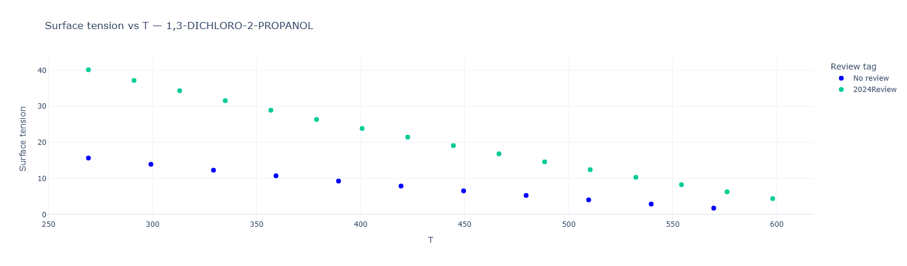
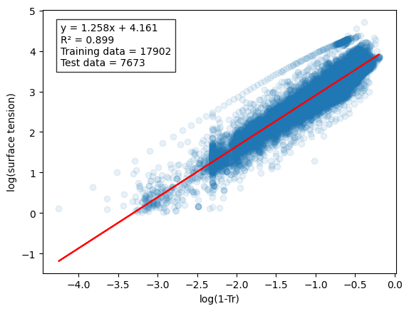
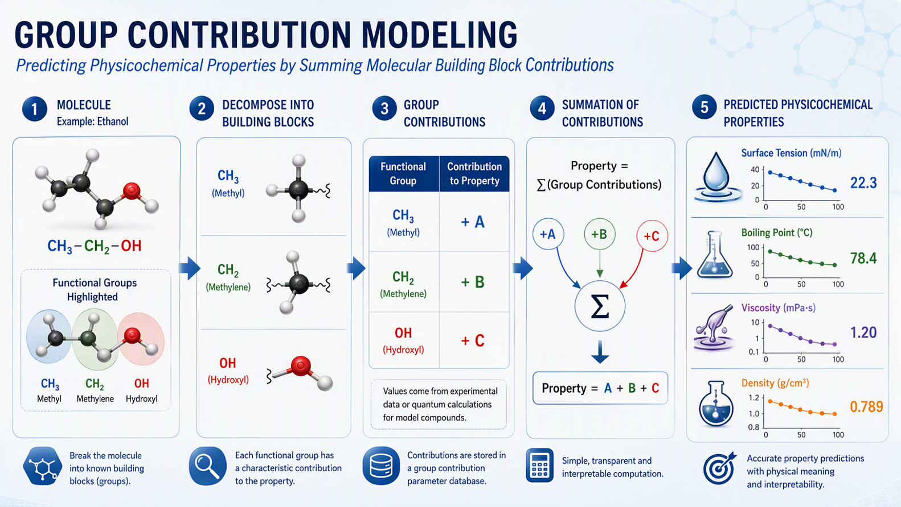

# Introducción
El objetivo de este proyecto es el modelado de la tensión superficial.   
La tensión superficial (TS) es una propiedad física de los líquidos y es la fuerza que hace que la superfície de dicho líquido se comporte como una membrana elástica debido a la atracción entre moléculas. Sus unidades son mN/m, y es una propiedad que depende de la temperatura.  
Es una propiedad importante en la industria química, ya que debe controlarse para aquellos productos que deben interactuar con una superfici, dispersarse, formar una película, generar gotas o penetrar en un sustrato.  
En Lubrizol, tenemos varios productos en el sector de Surface Sciences, que necesitan control de esta propiedad. Entre ellos:  
- Dispersiones, dispersantes, resinas y modificadores de superficie para tintas digitales sobre textiles, films, papel y cerámica.
- Pinturas y coatings.
- Formulaciones de activos cosméticos.

## ¿Qué aporta este proyecto?
Esta propiedad suele medirse usando un tensiómetro y empleando distintos métodos experimentales, pero lo que tienen en común todos ellos es que el producto ya debe estar acabado para que se puedan hacer estas mediciones. Es decir, si queremos ver qué formulación cumpliría con las necesidades de tensión superficial del uso destinado, tendríamos que hacer todas las formulaciones y luego medir la propiedad. Por lo tanto, eso nos limita a probar unas pocas formulaciones que creemos que son mejores candidatos, ya que cada fabricación y medición implica un gasto cuantioso de tiempo y de dinero.  
Si tenemos un modelo de esta propiedad, podemos pasar por él cientos o miles de formulaciones, para encontrar aquellos mejores candidatos para llevarlos a fabricación y validación con el método experimental apropiado.  
Entonces, a efectos de empresa, este proyecto permitiría hacer un screening amplio de formulaciones en minutos, y solo aplicar las pruebas experimentales a aquellas más prometedoras, ayudando así a agilizar la innovación de productos reduciendo el tiempo y el coste.

# Dataset
Para este proyecto, usaremos los datos de una base propietaria, con lo cual no publicaremos los datos en este repositorio, ni tampoco el modelo resultante.  
Los campos que cogemos de la base de datos son:
- ChemID: identificador del compuesto químico.
- Name: nombre del compuesto.
- Formula
- SMILES: código SMILES del compuesto
- Structure: estructura del compuesto
- Family: clasificación de familia a la que pertenece el compuesto
- Std_State: indica el estado de la materia en la que se encuentra el compuesto.
- T: temperatura
- Surface_tension: nuestro target, la tensión superficial.
- TC: temperatura crítica. Es una variable importante de cara a crear un modelo que no incumpla leyes físicas.
- Error: incertidumbre asociada al valor guardado en la base de datos.
- Acceptance: estado de aceptación de los datos por parte del staff.
  - A = Accepted. Datos aceptados por el staff del proyecto.
  - N = Not used (but acceptable). Datos aceptables, pero con una precisión menor o igual a la de los valores aceptados. Dentro del doble de la incertidumbre o no usados debido a tendencias inconsistentes.
  - U = Unevaluated. Datos no evaluados por el staff del proyecto.
  - R = Rejected. Datos rechazados debido a que se desvían más del doble de la incertidumbre o se consideran poco fiables.

## Limpieza y transformaciones
Para simplificar el estudio, solo cogeremos aquellos valores que hayan sido verificados y aceptados por el staff (Acceptance == "A") y los que tengan incertidumbres menores del 25%. Como estamos estudiando una propiedad de los líquidos, solo cogeremos aquellos compuestos cuyo estado de la materia sea líquido (Std_state == "L").  
Al obervar los datos, vemos que tenemos más nombres únicos que códigos SMILE, cosa que no es posible ya que a cada compuesto se le asigna un SMILE. Revisando más a fondo, podemos ver que hay compuestos que, después de una revisión, se han guardado añadiendo a su nombre la coletilla del año de revisión. Eliminaremos esa coletilla y auditaremos los valores para evitar casos como el de la imagen.  

Nos quedaremos con el valor de revisión, cuando este difiera mucho con el anterior. Nos quedaremos con ambos cuando sean muy similares.  
Los códigos SMILES contienen los elementos que componen el compuesto. Gracias a eso, podemos usarlos para detectar cuáles de ellos llevan los elementos más usados en las formulaciones de la empresa: Carbono, Oxígeno, Sulfuro, Fósforo y Nitrógeno.  
Con éstas limpiezas, el dataset que empezó con 52225 registros, pasa a 25649.  
El último cambio que hay que hacer tiene que ver con las unidades de la TS. En la base de datos las unidades son N/m, y como he dicho al inicio, las unidades típicas son mN/m. Así que, realizamos una simple conversión de unidades.  

  
# Creación de modelos
A modo de exploración, debemos empezar con modelos más sencillos y que sigan los métodos que típicamente usan los técnicos e ingenieros.

## 1. Uso de la ecuación de Yaws

La ecuación de Yaws describe la tensión superficial como: $\sigma = A(1-T_r)^n$ donde $T_r = \frac{T}{T_C}$
Usando esta ecuación, podemos hacer una regresión lineal:
$$
\log\sigma = \log A+n\log(1-T_r)
$$

### ¿Qué problema hay con este modelo?
Como usa la Temperatura crítica, nos obligaría a tenerla para todos los nuevos compuestos.

## 2. Generando variables químicas
Como el uso de las variables actuales no nos permite crear un modelo sin data leakage, usamos los SMILES para obtener:
- Contribución de grupos: es un método donde cogemos una molécula, la descomponemos en grupos funcionales, y miramos cómo la suma de dichos grupos contribuye a la propiedad X de dicha molécula.  Con esto creamos 29 predictores.
- Descriptores químicos. Escogemos los que tienen mayor relevancia del paquete RDkit:
  - Descriptores de polaridad e interacciones intermoleculares.
    - TPSA (Topological Polar Surface Area)
    - LogP: mide el balance entre el comportamiento hidrofóbico e hidrofílico. Nos da información de la polaridad y la hidrofobicidad.
  - Cargas parciales. Para poder mirar las cargas parciales, debemos calcular las cargas de cada átomo de la molécula, calculando las cargas parciales de Gasteiger para cada átomo. Así, obtendremos los valores que nos darán las cargas máximas y mínimas de cada compuesto.
  - E-State: el estado electrotopológico combina la información topologica molecular y el entorno electrónico.
  - Descriptores de tamaño y dispersión: peso molecular y contaje de átomos pesados.
  - Descriptores de enlaces de hidrógeno: importantes ya que este tipo de enlaces influencian las fuerzas intermoleculares cohesivas en un líquido.
  - LabuteASA: nos da una aproximación de la superficie molecular describiendo lo grande que es la molécula y el tipo de superficie que tiene.
  - SlogP_VSA: nos divide el área de la superficie molecular según la contribución de la superficie de van der Waals al valor de LogP.
  - PEOE_VSA: se refiere a la información que aportan las cargas parciales. Lo que nos mira es cómo los rangos de diferencias entre cargas parciales de los átomos, afecta a la superficie molecular.
  - SMR_VSA: nos dan información de la polarizabilidad y de las características de volumen y dispersión de la molécula.
  - Descriptores estructurales: proporcionan características estructurales básicas.
    - Contaje de anillos, que nos da información de la ciclicidad.
    - Anillos aromáticos, que captura todas aquellas estructuras aromáticas.
    - Enlaces rotables, que nos proporciona una medida de la flexibilidad de la molécula.
- Morgan Fingertips: es una codificación de fragmentos estructurales de las moléculas. Hay 2048 fragmentos. Si el valor para un fingertip es 1, entonces es que este fragmento está presente en la molécula.

## 3. Separación de los datos

